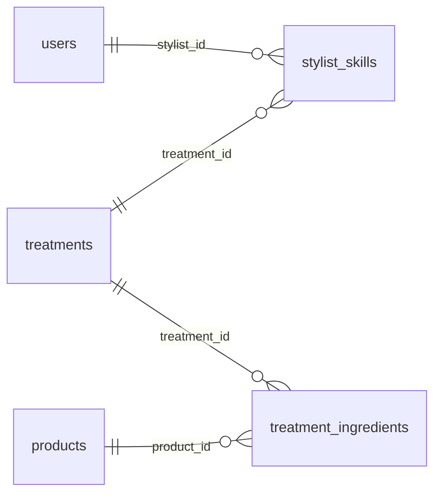
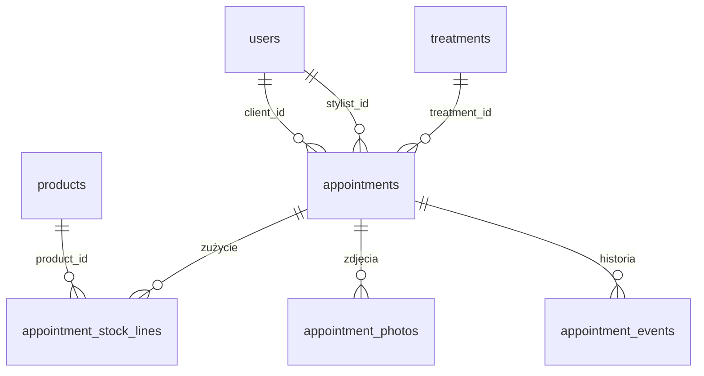

# Glamora — salon kosmetyczny

Aplikacja webowa do obsługi salonu kosmetycznego. Klientki przeglądają zabiegi, wybierają stylistkę i umawiają wizytę. Stylistki prowadzą kalendarz, a właścicielka (admin) zarządza ofertą, personelem i magazynem kosmetyków.

## Technologie

- Backend: NestJS, REST API, TypeORM
- Frontend: React, JavaScript, Vite
- Baza danych: PostgreSQL 16
- Docker Compose

## Uruchomienie

```powershell
Copy-Item .env.example .env
Copy-Item backend/.env.example backend/.env
```

**Docker (backend + baza + frontend):**

```bash
docker compose up --build
```

- Frontend: http://localhost
- API / Swagger: http://localhost:3000/api/docs
- PostgreSQL: localhost:5432

**Lokalnie:**

```bash
docker compose up db -d
cd backend && npm install && npm run start:dev
cd frontend && npm install && npm run dev
```

Frontend: http://localhost:5173

Schemat bazy powstaje z migracji przy starcie backendu. Ręcznie nakłada się ją w katalogu `backend` przez `npm run migration:run`.

Testy backendu: w katalogu `backend` uruchom `npm test`.

## Konta

Role:

- klientka — zakłada je publiczna rejestracja; w bazie startowej jest pięć takich kont
- stylistka — w bazie startowej są dwa konta, kolejne dodaje właścicielka
- właścicielka — zarządza kontami i rolami

Wszystkie konta startowe mają hasło `haslo1234`. Powstają przy starcie, jeśli jeszcze ich nie ma.

Właścicielka:

- `wlascicielka@glamora.local` — Ewa Adamska

Klientki:

- `zofia.nowak@example.com` — Zofia Nowak
- `hanna.wisniewska@example.com` — Hanna Wiśniewska
- `maria.wojcik@example.com` — Maria Wójcik
- `aleksandra.kaminska@example.com` — Aleksandra Kamińska
- `natalia.lewandowska@example.com` — Natalia Lewandowska

Stylistki:

- `karolina.zielinska@example.com` — Karolina Zielińska
- `magdalena.szymanska@example.com` — Magdalena Szymańska

Adres i hasło właścicielki można zmienić w `.env` przez `ADMIN_EMAIL` i `ADMIN_PASSWORD`.

## Magazyn

Kosmetyki startowe powstają przy starcie, jeśli jeszcze ich nie ma, i są przypięte do zabiegów. Właścicielka zmienia stany i skład w panelu. Zalogowana osoba widzi przy zabiegu, ile którego kosmetyku schodzi na jedną wizytę.

## Wizyty

Klientka umawia wizytę u stylistki, która wykonuje wybrany zabieg. Wizyta zajmuje cały czas trwania zabiegu, więc kolejna może zacząć się dopiero po jej zakończeniu. Dotyczy to kalendarza stylistki i wizyt tej samej klientki. Przy zapisie ze stanu schodzą kosmetyki zabiegu, a przy odwołaniu wracają. Po umówieniu i odwołaniu wizyty stylistka i właścicielka widzą wpis w historii.
Właścicielka zmienia uprawnienia do zabiegów w panelu personelu.

## Zdjęcia

Klientka dodaje zdjęcie inspiracji do wybranej wizyty. Stylistka i właścicielka widzą je przy tej rezerwacji.

## Główne funkcjonalności

- Rejestracja, logowanie i role: klientka, stylistka, admin
- Katalog zabiegów oraz umawianie, odwoływanie i podgląd wizyt
- Kalendarz stylistki z blokadą nachodzących się terminów
- Panel admina: zabiegi, personel i magazyn kosmetyków
- Zdjęcia inspiracji

Reguły biznesowe:

1. Brak kolizji terminów
2. Stylistka wykonuje tylko zabiegi, do których ma uprawnienia
3. Zabieg wymaga dostępnych kosmetyków na magazynie

## Model danych

Oferta i personel:



Wizyta. `client_id` i `stylist_id` to dwa osobne powiązania z `users`:



| Tabela | Pola poza kluczami |
| --- | --- |
| users | first_name, last_name, email, password_hash, role |
| treatments | name, description, duration_minutes, price |
| products | name, stock |
| treatment_ingredients | quantity_per_visit |
| stylist_skills | tylko para stylistka–zabieg |
| appointments | starts_at, ends_at, status |
| appointment_photos | file_name, mime_type |
| appointment_stock_lines | quantity |
| appointment_events | message, created_at |

## Dokumentacja REST API

Swagger: http://localhost:3000/api/docs

